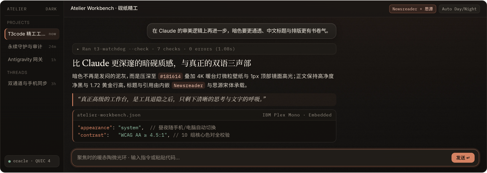
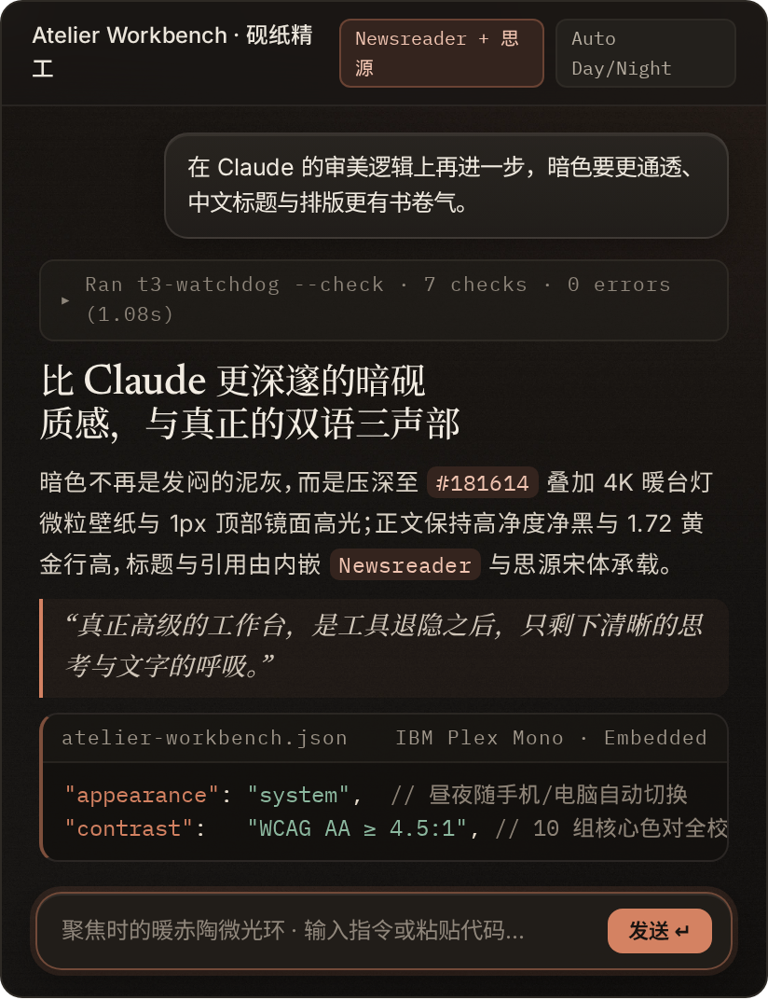

# Atelier Workbench · 砚纸精工

砚纸精工是一套为长时间阅读技术对话、文档和代码设计的 T3 Code 主题。它提供暖色深浅两套配色，分别为正文、引用和代码安排字体，并提高了错误提示文字的对比度。桌面端可以同步主题和配套壁纸，网页端和手机可直接导入主题 JSON。[T3 Code 官网](https://t3.codes)

Atelier Workbench is a light and dark theme for T3 Code, designed for long-form technical reading in Chinese and English. It ships with a desktop wallpaper and an importable theme for web and mobile.

## 预览

### 夜读胡桃炭墨 · 桌面深色

胡桃炭色底（`#181614`）搭配暖陶红（`#d48262`）。配套的 2560 × 1440 壁纸带有细纸纹，适合夜间阅读。



### 白昼馆藏霜纸 · 桌面浅色

象牙纸色底（`#f8f5ef`）搭配深墨正文（`#1e1b18`）和朱砂色强调（`#b85636`）。浅色纸纤维纹理已内嵌到主题。


### 手机浏览器 · 深色



## 字体与可读性

- **标题和引用**用内嵌的 Newsreader 500 排版拉丁文字，中文优先使用设备上的宋体或思源宋体。
- **正文和界面**使用 Inter Variable 与设备上的中文无衬线字体，正文行高为 `1.72`。
- **代码和数字**用内嵌的 IBM Plex Mono 400，数字等宽排列。两个内嵌的拉丁字体随主题加载。
- 两套配色中，正文、消息和代码等由构建脚本检查的前景与背景组合对比度至少为 **4.5:1**，脚本检查的错误提示组合至少为 **7:1**。

## 安装和切换

### 网页与手机

1. 保存主题文件。[下载 atelier-workbench.json](https://raw.githubusercontent.com/haozhanxi-source/t3code-atelier-workbench/main/atelier-workbench.json)
2. 在 T3 Code 打开 **Settings → Appearance → Add a theme**。
3. 选择下载的文件，或把文件内容粘贴到 **Theme JSON**，再点击 **+ Add theme**。
4. 选择 **Atelier Workbench · 砚纸精工**。把外观模式设为 **System**，主题会跟随系统的深浅色设置切换。

### 桌面

克隆仓库后，在仓库目录中运行对应脚本。

| 系统 | 命令 |
| --- | --- |
| macOS / Linux | `./sync-desktop.sh` |
| Windows PowerShell | `.\sync-desktop.ps1` |

脚本将主题 JSON 和 WebP 壁纸复制到 T3 Code 的主题目录。打开 **Settings → Appearance**，选中 **Atelier Workbench · 砚纸精工**。需要随系统切换深浅色时，将外观模式设为 **System**。

### T3 Code 服务器默认主题

在运行 T3 Code 的服务器上执行：

```bash
git clone https://github.com/haozhanxi-source/t3code-atelier-workbench.git
cd t3code-atelier-workbench
./sync-desktop.sh
t3 theme set atelier-workbench
```

这个设置适用于服务器提供的网页端和服务器本机的桌面端。连接这台服务器的其他桌面设备可以按上面的桌面步骤安装。

## 从源码构建

构建脚本使用 Python 3.10+、NumPy 和 Pillow。构建会生成主题 JSON、WebP 壁纸和同步脚本。

```bash
python3 scripts/build_theme.py
```

## 许可证

- 主题、构建脚本和随附壁纸采用 MIT 许可证。[LICENSE](LICENSE)
- 内嵌的 Newsreader 和 IBM Plex Mono 字体子集采用 SIL Open Font License 1.1。
