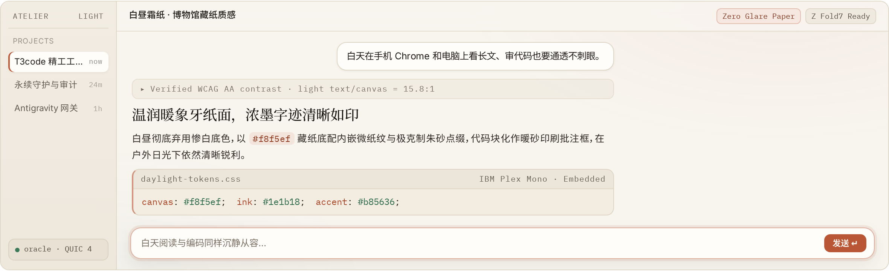

# Atelier Workbench · 砚纸精工

> 为 **[T3 Code](https://t3.codes)** 打造的高定昼夜双模书卷工作台主题 —— 兼顾长时间中英文技术阅读的优雅排版、极克制的暖中性纸墨材质与多端一致体验（桌面端 / Web / 手机 Chrome Web）。
>
> A dual-mode (Dark & Light) editorial workbench theme for **T3 Code**, built around warm archival neutrals, embedded bilingual tri-voice typography, and WCAG-verified legibility across Desktop, Web, and Mobile.

---

## 实景预览 · Preview

### 夜间模式 · 夜读胡桃炭墨（Dark Mode）


### 白昼模式 · 馆藏霜纸（Light Mode）


### 移动端 · 折叠屏 / 手机 Chrome Web（Mobile）


---

## 设计理念 · Design Philosophy

大多数编辑器与 AI 聊天主题只是替换高饱和霓虹色板，久看容易视觉疲劳，且中英文混排缺乏呼吸感。**Atelier Workbench · 砚纸精工** 采用「**理性工作台骨架 × 人文出版书卷气**」的设计原则：

1. **昼夜双模暖中性色阶（Warm Neutrals）**
   - 摒弃冷蓝死黑与惨白眩光，全套中性灰均向暖胡桃炭与博物馆藏纸偏移，**95% 保持克制留白，仅 5% 使用低饱和印泥赤陶作交互焦点**。
   - **夜间模式（夜读胡桃炭墨）**：压深至通透深炭底（`#181614` / 侧栏 `#13110f`），叠加本地算法生成的 **2560×1440 微粒暗纸暖晕壁纸**（`atelier-workbench.webp`，消除 OLED 渐变色带）与 **1px 顶部镜面高光**；若在云端 Web 仅导入 JSON（无外置壁纸），自动降级为纯 CSS 暖台灯径向渐变 + 内嵌微粒 SVG，保持 95% 一致质感。
   - **白昼模式（馆藏霜纸）**：暖象牙宣纸底（`#f8f5ef`）+ 极细内嵌 SVG 纸纤肌理 + 浓墨正文（`#1e1b18`），日光下清晰不刺眼。

2. **三声部中英文排版系统（Tri-Voice Bilingual Typography · 零外部请求）**
   - **Voice 1 · 标题与引用（出版衬线）**：将精简拉丁子集化的 **Newsreader 500**（`WOFF2` base64）直接内嵌进主题 CSS，衔接系统原生 `Noto Serif CJK SC` / `Source Han Serif SC` / `Songti SC`，免装字体即可让中英文标题同框保持书卷气。
   - **Voice 2 · 正文与工作台（理性净黑）**：`Inter Variable` 搭配 `PingFang SC` / `HarmonyOS Sans SC` / `MiSans` / `Noto Sans CJK SC`，正文采用无单位 `1.72` 黄金行高、中文标点挤压（`"palt" 1, "kern" 1`）、`font-size-adjust: from-font`（统一中英与行内代码视觉字高）；已发送的用户消息气泡单独收紧至 `1.55` 行高并去除末段多余底边距，紧凑利落。
   - **Voice 3 · 代码与标尺（人文等宽）**：同步内嵌 **IBM Plex Mono 400**（`WOFF2` base64）与 `tabular-nums` 等宽数字，代码块采用带左侧赤陶呼吸细线的「印刷批注框」样式。

3. **工程工作台细节精修 & 严格可访问性校验**
   - 侧边栏激活线程以「微暖浮层 + 左侧 2px 赤陶书签线」锚定；`work` 工具调用行低噪呈现，正文结论突出；全站 `svg.lucide` 图标线宽收细至 `1.5px`，滚动条收细至 `6px`。
   - 构建脚本内建自动化对比度断言：全部核心前景/表面对均满足 **WCAG AA ≥ 4.5:1**，错误提示（`error` / `errorForeground`）满足 **≥ 7.0:1**；同时严格遵守 T3 Code CSS 守卫规则（`< 50,000` 字符、零 `@import`、零外部 `url()`、仅使用稳定 `data-*` 选择器）。

---

## 核心色板与对比度 · Palette & Contrast

| 语义角色 Role | 夜间模式 Dark（夜读胡桃炭墨） | 白昼模式 Light（馆藏霜纸） | 用途说明 |
| :--- | :--- | :--- | :--- |
| `canvas` | `#181614` | `#f8f5ef` | 主画布底色 |
| `sidebar` | `#13110f` | `#f1ece2` | 左侧项目与会话栏 |
| `surface` / `messageSurface` | `#211e1b` / `#24211d` | `#fffdf9` | 卡片、输入浮层与用户消息气泡 |
| `text` | `#ebe5db` | `#1e1b18` | 主正文（对比度 > 13:1） |
| `textMuted` | `#9e9589` | `#655c52` | 次要说明与时间戳（≥ 4.5:1） |
| `accent` | `#d48262` | `#b85636` | 发送键、焦点环、左侧激活书签线 |
| `codeBackground` / `codeForeground` | `#13110f` / `#e5dacb` | `#f1ebe0` / `#2a251f` | 代码块与行内代码 |
| `errorSurface` / `errorForeground` | `#331e1d` / `#ffc2bc` | `#f9e7e6` / `#842c29` | 错误提示条（对比度 ≥ 7.0:1） |
| `warningSurface` / `warningForeground` | `#33281a` / `#f2c987` | `#f8efe0` / `#74470a` | 警告提示条（≥ 6.9:1） |
| `updateSurface` / `updateForeground` | `#1d2b23` / `#a9d6bd` | `#e6f2ec` / `#245a40` | 状态与更新提示（≥ 7.0:1） |

---

## 安装与使用 · Installation

> 建议在 T3 Code 的 **Settings → Appearance** 中将外观模式设为 **System**，即可随操作系统深浅色自动切换「夜读胡桃炭墨 / 白昼馆藏霜纸」。

### 方式 1：T3 Code CLI 一键安装（推荐 Linux / macOS / 服务器端）
```bash
git clone https://github.com/haozhanxi-source/t3code-atelier-workbench.git
cd t3code-atelier-workbench
./sync-desktop.sh
t3 theme set atelier-workbench
```

### 方式 2：macOS / Windows 桌面端同步（完整含 4K 壁纸）
- **macOS / Linux**：克隆或下载本仓库后执行 `./sync-desktop.sh`
- **Windows（PowerShell）**：执行 `.\sync-desktop.ps1`

脚本会将 `atelier-workbench.json` 与 `atelier-workbench.webp` 复制到 `${T3CODE_HOME:-~/.t3}/userdata/themes/`。随后在 T3 Code 桌面端打开 **Settings → Appearance**，选中 **Atelier Workbench · 砚纸精工** 并将外观设为 **System**。

### 方式 3：Web 端 / 手机 Chrome Web（`app.t3.codes` 免下载直接导入）
1. 打开 [atelier-workbench.json (Raw)](https://raw.githubusercontent.com/haozhanxi-source/t3code-atelier-workbench/main/atelier-workbench.json) 并复制全部内容（或下载该 JSON 文件）。
2. 在 T3 Code Web 打开 **Settings → Appearance → Add a theme**。
3. 滑到底部 **`Theme JSON`** 输入框粘贴（或选择文件），点击 **`+ Add theme`**（若已安装旧版，在弹窗中点 **`Update existing`** 覆盖升级即可）。
4. 选中 **Atelier Workbench · 砚纸精工**，外观设为 **System**。

*(注：T3 Code 原生 iOS/Android App 目前官方暂不支持自定义主题；手机端推荐使用 Chrome 打开 Web 版并「添加到主屏幕」以 PWA 方式体验完整皮肤。)*

---

## 目录结构 · Repository Structure

```text
.
├── atelier-workbench.json   # 完整主题配置（含双模 60+ 色值、内嵌 WOFF2 字体与完整 CSS）
├── atelier-workbench.webp   # 2560×1440 程序化生成的暗胡桃微粒宣纸壁纸
├── scripts/
│   └── build_theme.py       # 可复现构建脚本（壁纸生成 + 字体子集内嵌 + WCAG 对比度与 CSS 守卫校验）
├── sync-desktop.sh          # macOS / Linux 一键安装到 ~/.t3/userdata/themes/
├── sync-desktop.ps1         # Windows PowerShell 一键安装脚本
├── assets/                  # 深色 / 浅色 / 移动端预览图
├── LICENSE
└── README.md
```

---

## 从源码自定义构建 · Rebuild from Source

如果你想微调色板、行高或重新生成壁纸，可修改 `scripts/build_theme.py` 后运行：

```bash
# 仅在当前仓库重建 JSON 与壁纸
python3 scripts/build_theme.py

# 重建并同步壁纸到本机 T3CODE_HOME/userdata/themes/
python3 scripts/build_theme.py --install
```

依赖：Python 3.10+、`numpy`、`Pillow`（仅重新生成 `.webp` 壁纸时需要）。构建时会自动执行全部 WCAG 对比度与 T3 CSS 守卫校验，不达标会直接报错中止。

---

## 开源协议 · License

- 主题配置、构建脚本、同步脚本与程序化壁纸：[MIT License](./LICENSE)
- 内嵌字体子集（`Newsreader`、`IBM Plex Mono`）：[SIL Open Font License 1.1](https://scripts.sil.org/OFL)
